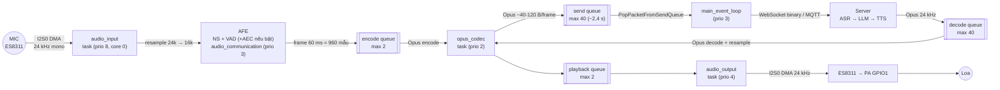
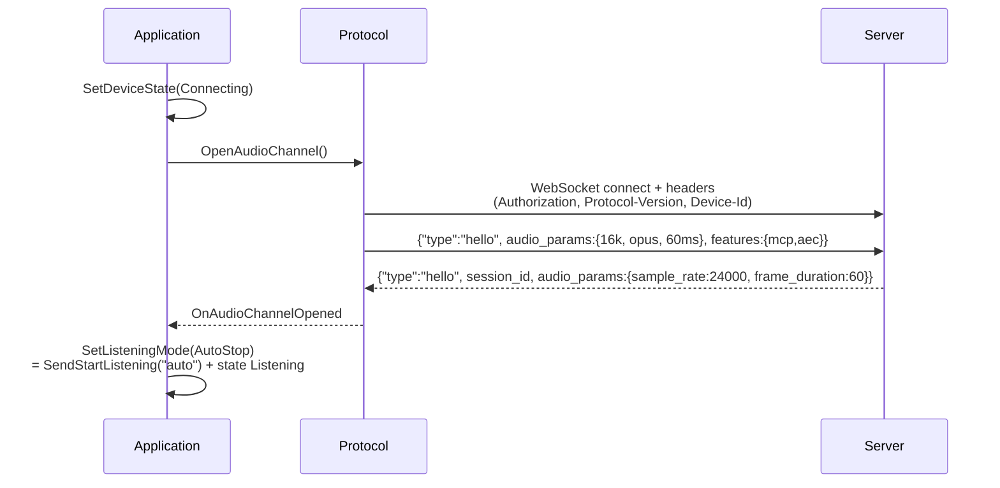
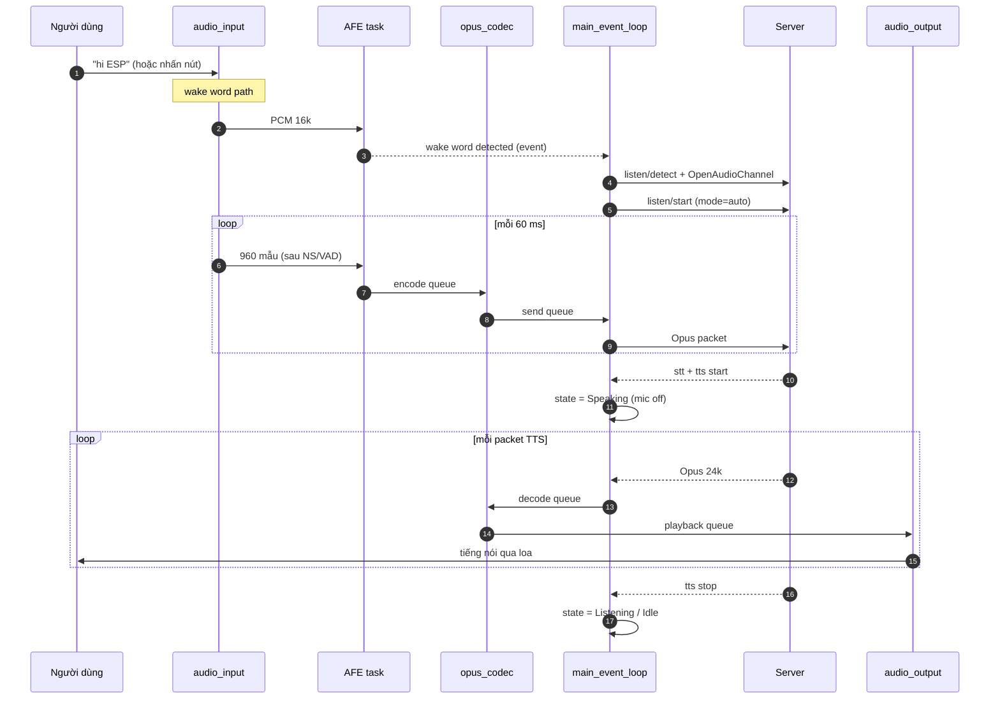

# Luồng xử lý: Micro → AI → Loa

Tài liệu mô tả **chính xác theo code** đường đi của một câu nói: từ mẫu PCM đầu
tiên đọc từ micro, qua xử lý/ mã hoá/ gửi server, đến khi tiếng trả lời phát ra
loa. Trạng thái build hiện tại: **không bật AEC** (cả device lẫn server), VAD do
server quyết định.

---

## 1. Tổng quan trong một hình



---

## 2. Thông số thực tế

| Thông số | Giá trị | Nguồn |
|---|---|---|
| Codec | ES8311, I2S0, I2C0 addr 0x18 | `boards/.../config.h` |
| Sample rate vào/ra codec | **24 000 Hz**, mono, không có kênh reference | `AUDIO_INPUT/OUTPUT_SAMPLE_RATE` |
| Encoder Opus | 16 000 Hz, mono, complexity 0 | `audio_service.cc:38-39` |
| Frame | **60 ms** (960 mẫu @16 kHz) | `OPUS_FRAME_DURATION_MS` |
| encode queue | tối đa 2 task PCM | `MAX_ENCODE_TASKS_IN_QUEUE` |
| send queue | tối đa 40 packet ≈ **2,4 s** audio | `MAX_SEND_PACKETS_IN_QUEUE` |
| decode queue | tối đa 40 packet | `MAX_DECODE_PACKETS_IN_QUEUE` |
| playback queue | tối đa 2 task PCM | `MAX_PLAYBACK_TASKS_IN_QUEUE` |
| AEC | **tắt** (`aec_mode_ = kAecOff`) | `sdkconfig.defaults` |
| Wake word | AFE wakenet, gửi kèm dữ liệu lên server | `CONFIG_USE_AFE_WAKE_WORD`, `CONFIG_SEND_WAKE_WORD_DATA` |

---

## 3. Bước 0 — Idle: chờ đánh thức

Thiết bị ở `kDeviceStateIdle`, `EnableWakeWordDetection(true)` +
`EnableVoiceProcessing(false)`.

- `audio_input` đọc micro, **chỉ đưa dữ liệu cho wake word** (`wake_word_->Feed`).
- Task `audio_detection` của AFE chạy wakenet; khi khớp từ khoá:
  `AfeWakeWord::AudioDetectionTask()` → callback `on_wake_word_detected` →
  `xEventGroupSetBits(MAIN_EVENT_WAKE_WORD_DETECTED)`.
- `main_event_loop` gọi `Application::OnWakeWordDetected()`.

Hai đường vào khác:
- **Nhấn nút BOOT** → `ToggleChatState()` → `StartListening()`.
- **Text qua UART** → `SendTextQuery()` → `WakeWordInvoke()` (xem `docs/UART_TEXT_CHAT.md`).

---

## 4. Bước 1 — Mở kênh (Connecting)



Chi tiết quan trọng:
- `OnAudioChannelOpened` tắt power-save và **cảnh báo nếu sample rate của server
  khác sample rate loa** (`Server sample rate ... does not match device output`).
- Vì `aec_mode_ == kAecOff`, `SetListeningMode()` dùng `kListeningModeAutoStop` →
  thiết bị nói server "tôi nghe đây, hãy tự cắt khi hết tiếng".

---

## 5. Bước 2 — Thu âm và đẩy lên server (Listening)

### 5.1 `audio_input` (prio 8, core 0, stack 6 KB PSRAM)

```
AudioInputTask()
  └─ ReadAudioData(data, 16000, samples):
       ├─ nếu input đang tắt → codec_->EnableInput(true)
       ├─ codec_->InputData()  → I2S0 DMA → PCM 24 kHz mono
       └─ input_resampler_ 24 kHz → 16 kHz
  └─ audio_processor_->Feed(data)
```

- `GetFeedSize()` của AFE quyết định mỗi lần đọc bao nhiêu mẫu (theo model).
- Tiết kiệm điện: timer `audio_power_timer` 1 s kiểm tra, nếu **quá 15 s**
  (`AUDIO_POWER_TIMEOUT_MS`) không có dữ liệu vào/ra thì gọi
  `codec_->EnableInput(false)` / `EnableOutput(false)` và dừng timer.
  `ReadAudioData()` / `AudioOutputTask()` tự bật lại khi cần; sau khi bật input
  còn chờ `audio_input_need_warmup_` 120 ms để DMA ổn định.

### 5.2 `audio_communication` (prio 3) — AFE

```
AudioProcessorTask()
  └─ fetch_with_delay()  →  res->data (đã qua NS, VAD, AEC nếu bật)
       ├─ VAD đổi trạng thái → callback on_vad_change  (hiện chỉ đổi LED)
       └─ gom đủ 960 mẫu (60 ms) → output_callback
```

`output_callback` chính là `PushTaskToEncodeQueue(kAudioTaskTypeEncodeToSendQueue)`.

**Backpressure:** `PushTaskToEncodeQueue` **block** nếu encode queue đã có 2 task —
tức là nếu server chậm, áp lực sẽ dội ngược về AFE/mic thay vì tràn RAM.

### 5.3 `opus_codec` (prio 2, stack 25 KB PSRAM) — encode

```
OpusCodecTask()
  ├─ encode: PCM 960 mẫu → Opus packet (16 kHz, 60 ms)
  │    └─ audio_send_queue_.push_back()  (max 40)
  │    └─ callbacks_.on_send_queue_available()
  └─ decode: (xem bước 4)
```

### 5.4 `main_event_loop` (prio 3) — gửi qua mạng

```
on_send_queue_available → xEventGroupSetBits(MAIN_EVENT_SEND_AUDIO)
MainEventLoop:
  while (packet = PopPacketFromSendQueue())
      if (!protocol_->SendAudio(packet)) break;
```

- `WebsocketProtocol::SendAudio()`: binary frame, tuỳ `version`:
  - v1: Opus thô
  - v2: `BinaryProtocol2{version,type=0,reserved,timestamp,payload_size,payload}`
  - v3: `BinaryProtocol3{type=0,reserved,payload_size,payload}`
- `MqttProtocol` gửi qua topic UDP/JSON tương ứng.
- Nếu socket chết → `SendAudio` trả false → dừng vòng lặp, chờ sự kiện lỗi.

### 5.5 Tắt mic khi server bắt đầu nói

Khi nhận `{"type":"tts","state":"start"}` → `SetDeviceState(Speaking)`:
`EnableVoiceProcessing(false)` + `EnableWakeWordDetection(IsAfeWakeWord())`.
Mic dừng stream, chỉ còn AFE wake word (để có thể nói xen ngang).

---

## 6. Bước 3 — Server làm gì (ngoài thiết bị)

```
Opus 16k ─► ASR ─► (stt json) ─► LLM ─► (llm:emotion) ─► TTS ─► Opus 24k
```

Thiết bị nhận xen kẽ:
- `{"type":"stt","text":...}` → hiện câu người dùng trên LCD.
- `{"type":"llm","emotion":"happy"}` → đổi biểu cảm/emoji.
- `{"type":"tts","state":"start"}` → chuyển `Speaking`.
- `{"type":"tts","state":"sentence_start","text":...}` → hiện phụ đề từng câu.
- Opus binary → phát.
- `{"type":"tts","state":"stop"}` → kết thúc lượt.

---

## 7. Bước 4 — Nhận và phát tiếng trả lời (Speaking)

### 7.1 Vào decode queue

```cpp
protocol_->OnIncomingAudio([this](std::unique_ptr<AudioStreamPacket> packet) {
    if (device_state_ == kDeviceStateSpeaking) {     // ← cửa lọc duy nhất
        audio_service_.PushPacketToDecodeQueue(std::move(packet));
    }
});
```

- Chỉ nhận khi **đang Speaking** → tránh trộn tiếng server với mic.
- Queue đầy (40 packet ≈ 2,4 s) → packet bị **bỏ** (`wait` mặc định = `false`
  trong `AudioService::PushPacketToDecodeQueue`), không chặn luồng mạng.

### 7.2 `opus_codec` (prio 2) — decode

```
if (decode queue có packet && playback queue < 2):
    SetDecodeSampleRate(packet->sample_rate, packet->frame_duration)   // thích ứng 16k/24k
    opus_decoder_->Decode() → PCM
    if (decoder_rate != codec->output_sample_rate())
        output_resampler_.Process(...)                                  // vd 16k → 24k
    playback_queue_.push_back(task)
```

- `SetDecodeSampleRate` **tạo lại decoder** nếu server đổi sample rate/frame giữa
  chừng (ví dụ 24 kHz cho nhạc, 16 kHz cho TTS).
- Lỗi decode → log `Failed to decode audio`, bỏ packet.

### 7.3 `audio_output` (prio 4, stack 3 KB)

```
AudioOutputTask()
  ├─ chờ playback queue có dữ liệu (condition_variable)
  ├─ nếu loa đang tắt → codec_->EnableOutput(true)
  ├─ codec_->OutputData(pcm) → I2S0 DMA → ES8311 → PA (GPIO1) → loa
  └─ last_output_time_ = now   (dùng cho power-save)
```

- Chỉ **một** task ghi I2S TX → không cần lock audio phần cứng.
- `codec_->OutputData()` ghi blocking theo DMA, nên nhịp phát đúng 24 kHz.

---

## 8. Bước 5 — Kết thúc lượt

| Sự kiện | Kết quả |
|---|---|
| `tts stop` + `listening_mode_ == AutoStop` (build này) | → `Listening` (mic mở lại, chờ câu tiếp) |
| `tts stop` + `ManualStop` | → `Idle` (tắt mic, bật wake word) |
| Người dùng nhấn nút | `StopListening()` → gửi `listen/stop` → `Idle` |
| Wake word khi đang nói | `AbortSpeaking()` → gửi `abort` → nghe tiếp |
| Server đóng socket | `OnAudioChannelClosed` → bật power-save → `Idle` |
| ~60 s không có tiếng | Server tự đóng kênh |
| Timeout 120 s không nhận gì | `Protocol::IsTimeout()` → lỗi mạng → `Idle` + alert |

---

## 9. Toàn cảnh theo thời gian



---

## 10. Task & queue (bảng tra)

| Task | Prio | Core | Stack | Nhiệm vụ |
|---|---|---|---|---|
| `audio_input` | 8 | 0 | 6 KB (PSRAM) | đọc I2S RX, resample, feed AFE/wake word |
| `audio_communication` | 3 | – | 3 KB | AFE fetch: NS/VAD/AEC → frame 60 ms |
| `opus_codec` | 2 | – | 25 KB (PSRAM) | encode (lên) + decode (xuống) |
| `audio_output` | 4 | – | 3 KB | ghi I2S TX |
| `main_event_loop` | 3 | – | 5 KB | gửi audio, xử lý JSON, đổi state |

| Queue | Kiểu | Giới hạn | Ý nghĩa |
|---|---|---|---|
| `audio_encode_queue_` | PCM 960 mẫu | 2 | chống dồn khi encode chậm |
| `audio_send_queue_` | Opus packet | 40 (~2,4 s) | Opus nhỏ nên giữ được buffer dài |
| `audio_decode_queue_` | Opus packet | 40 | đệm khi mạng xuống chậm |
| `audio_playback_queue_` | PCM | 2 | đệm ngay trước khi ra loa |

---

## 11. Điểm dễ gặp lỗi

| Hiện tượng | Nguyên nhân thường gặp | Xem ở |
|---|---|---|
| Có log "Server sample rate ... does not match" | server trả 16 kHz nhưng loa 24 kHz → phải resample, dễ méo tiếng | `OnAudioChannelOpened` |
| Nghe được, không có tiếng trả lời | không ở `Speaking` khi packet tới (state sai) | `OnIncomingAudio` |
| Tiếng bị ngắt quãng | send/decode queue đầy, mạng chậm | các `MAX_*_IN_QUEUE` |
| Loa rè khi vừa nói vừa nghe | AEC đang tắt → dùng `kListeningModeAutoStop` thay vì `realtime` | `SetListeningMode` |
| Wake word không ăn khi đang nói | chỉ AFE wake word được bật trong `Speaking` | `SetDeviceState` |
| Mic "câm" sau khi đổi trạng thái | `EnableVoiceProcessing`/`EnableWakeWordDetection` sai cặp | `audio_service.cc:520-560` |
| Trễ ~2 s | send queue đã đầy 40 packet (mất/buffer) | `MAX_SEND_PACKETS_IN_QUEUE` |

---

## 12. Muốn thay đổi gì thì sửa ở đâu

| Muốn | Sửa |
|---|---|
| Đổi frame 60 ms → 20 ms (độ trễ thấp hơn) | `OPUS_FRAME_DURATION_MS` (phải khớp server) |
| Bật AEC trên thiết bị | `CONFIG_USE_DEVICE_AEC=y` + codec phải có kênh reference (board này **không có**) |
| Bật VAD phía server | `CONFIG_USE_SERVER_AEC=y`, timestamp sẽ được đính vào packet v2 |
| Nghe/xuống 16 kHz | đổi `AUDIO_INPUT/OUTPUT_SAMPLE_RATE` = 16000 (bớt resample) |
| Tăng buffer chống mạng chậm | `MAX_SEND_PACKETS_IN_QUEUE`, `MAX_DECODE_PACKETS_IN_QUEUE` |
| Đổi độ nhạy VAD | `AfeAudioProcessor::Initialize()`: `vad_mode`, `vad_min_noise_ms` |
| Tắt NS cho nhẹ CPU | `afe_config->ns_init = false` |
