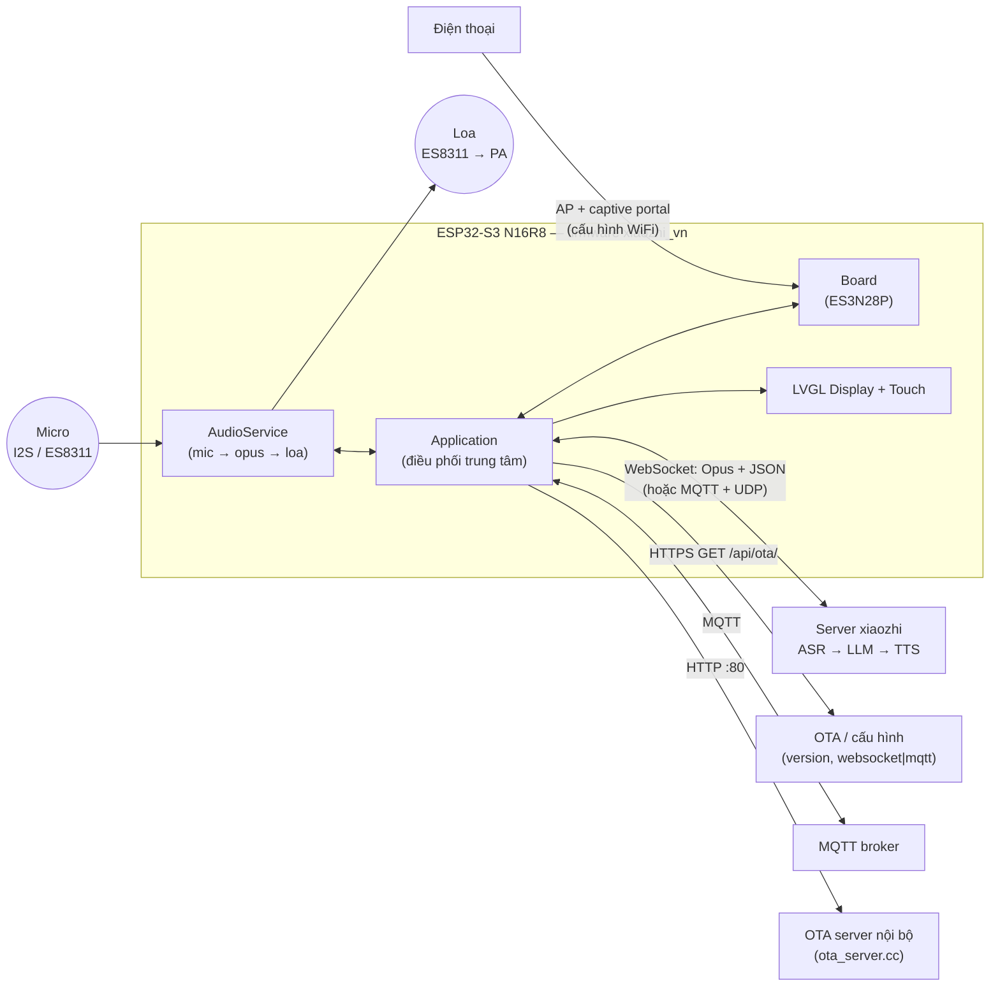
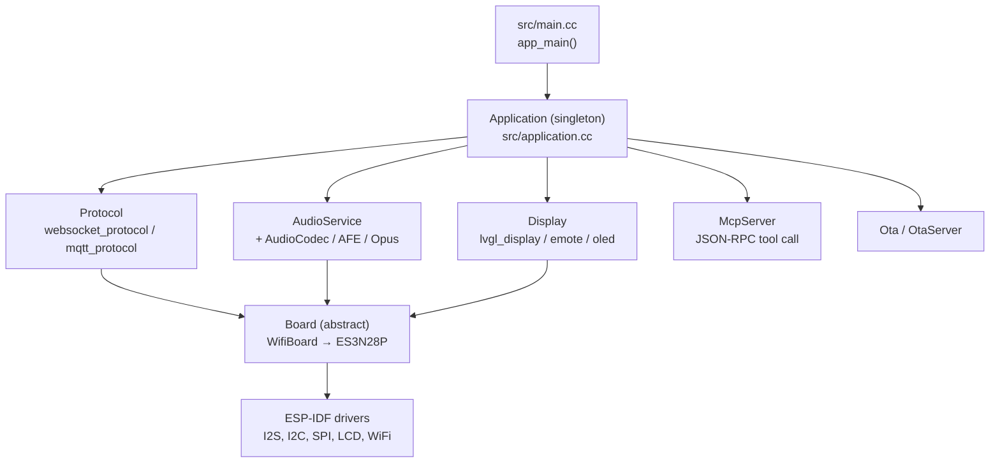
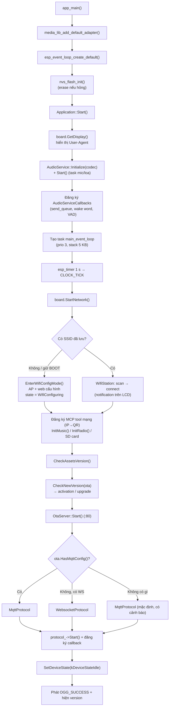
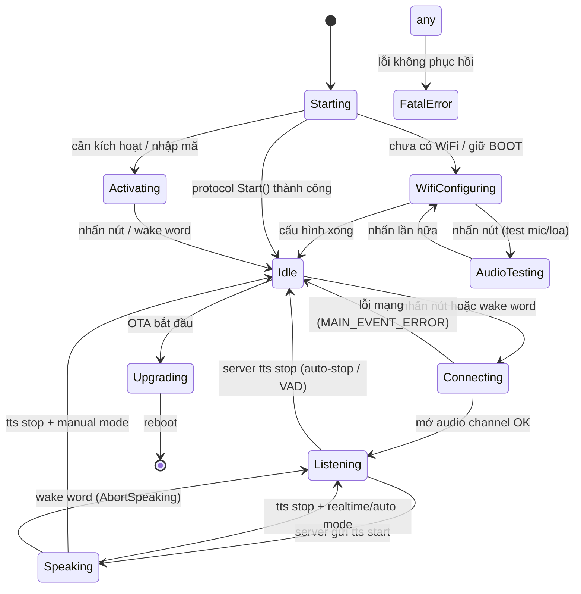
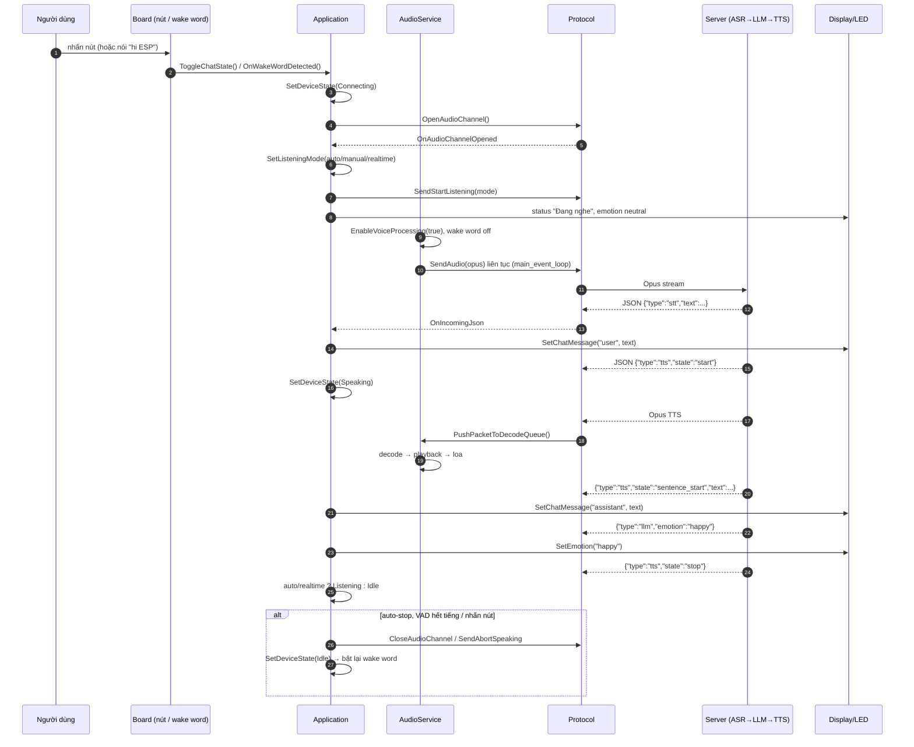
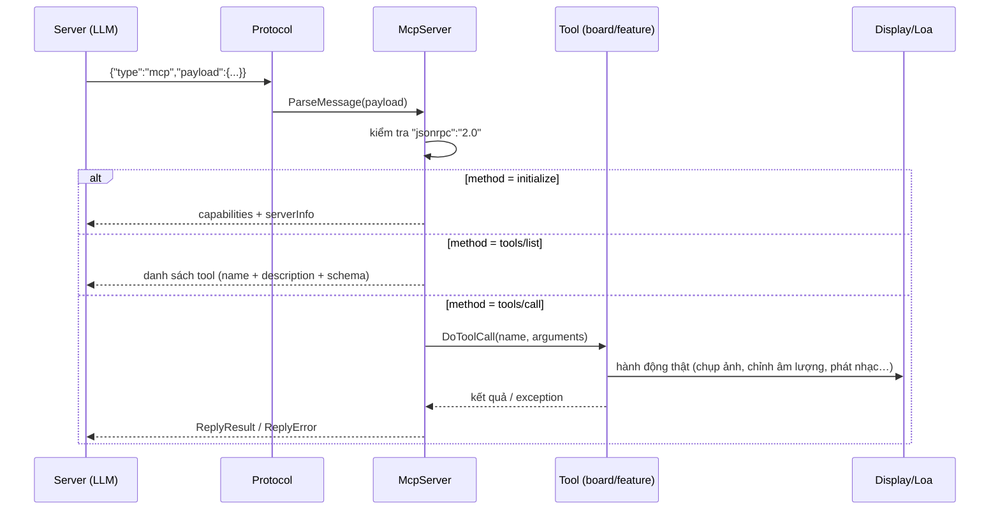
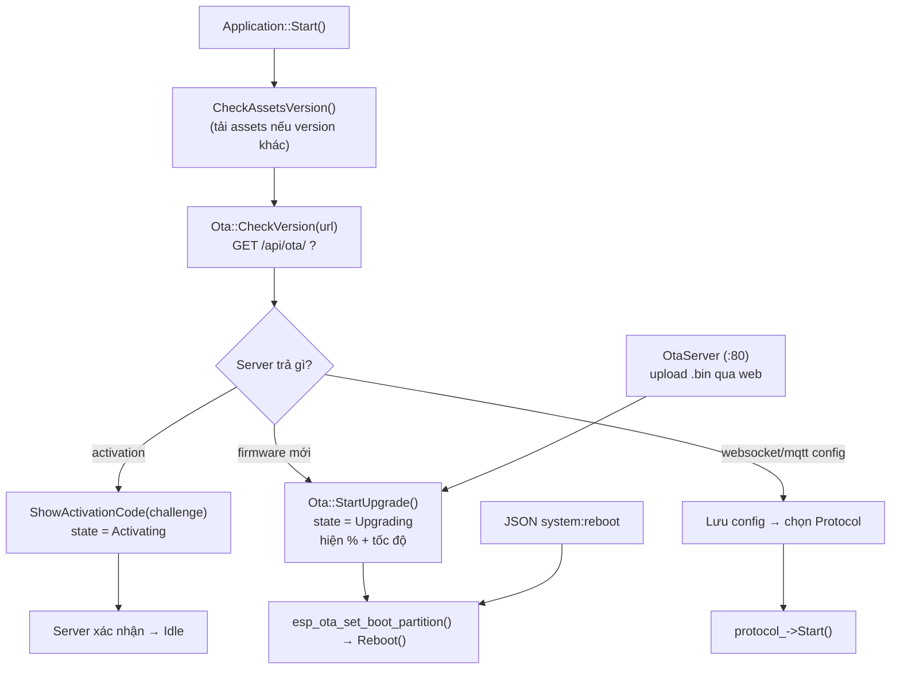
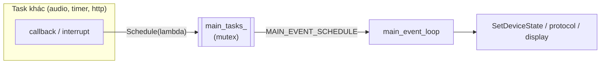

# Sơ đồ hoạt động — xiaozhi-esp32 (ES3N28P, ESP32-S3 N16R8)

Tài liệu mô tả luồng hoạt động thực tế của firmware, dựa trên code trong `src/`.
Dùng để tra cứu khi sửa code hoặc debug trên board thật.

---

## 1. Thiết bị nói chuyện với ai?



Điểm cốt lõi: **thiết bị không tự xử lý ASR/LLM/TTS**. Nó chỉ làm 3 việc:
thu âm → mã hoá Opus → gửi lên server; nhận Opus → giải mã → phát ra loa;
và thực thi lệnh (MCP tool, đổi UI, OTA) do server yêu cầu.

---

## 2. Kiến trúc phân tầng



| Tầng | File chính | Trách nhiệm |
|---|---|---|
| Khởi động | `src/main.cc` | `media_lib` adapter, event loop, NVS, gọi `Application::Start()` |
| Điều phối | `src/application.cc/.h` | máy trạng thái, event loop, chọn protocol, OTA, media |
| Giao thức | `src/protocols/*` | WebSocket/MQTT, đóng gói Opus + JSON, callback sự kiện |
| Âm thanh | `src/audio/*` | AFE wake word, VAD, Opus encode/decode, queue, AEC |
| Hiển thị | `src/display/*` | LVGL, emoji, status bar, QR, spectrum |
| Công cụ | `src/mcp_server.cc`, `src/features/mcp_server_features.cc` | MCP JSON-RPC (`tools/list`, `tools/call`) |
| Phần cứng | `src/boards/xiaozhi-ai-iot-vietnam-es3n28p-lcd-2.8/*` | ES8311, ILI9341, touch, LED, pin |

---

## 3. Luồng khởi động



Ghi chú: `SetDeviceState(kDeviceStateIdle)` bật **wake word detection** và tắt
voice processing — thiết bị chờ đánh thức.

---

## 4. Máy trạng thái thiết bị

Nguồn: `src/device_state.h`, `Application::SetDeviceState()`.



Mỗi lần đổi trạng thái, `SetDeviceState()` làm tuần tự:

1. `DeviceStateEventManager::PostStateChangeEvent(prev, new)` — cho phía UI/feature.
2. Rời `Idle` → `StopOtherMedia()` + xoá QR overlay.
3. `led->OnStateChanged()` — LED báo trạng thái.
4. Theo state: đổi status/emotion trên LCD, bật/tắt voice processing & wake word,
   gửi `SendStartListening(listening_mode)`, `ResetDecoder()`.

---

## 5. Luồng âm thanh (2 chiều, khác task)

Nguồn: `src/audio/audio_service.h` (comment đầu file) + `audio_service.cc`.

```mermaid
flowchart LR
    MIC(("MIC<br/>ES8311")) --> IN["audio_input_task<br/>(core riêng)"]
    IN --> PROC["Processors<br/>AFE: AEC / NS / VAD<br/>Wake word detect"]
    PROC -->|"PCM 16 kHz"| EQ[["Encode Queue<br/>(max 2 task)"]]
    EQ --> ENC["OpusCodecTask<br/>Opus Encoder 60 ms/frame"]
    ENC --> SQ[["Send Queue<br/>(max 40 packet)"]]
    SQ --> NET["protocol_->SendAudio()<br/>(main_event_loop)"]
    NET --> SERVER["Server"]

    SERVER --> DQ[["Decode Queue<br/>(max 40 packet)"]]
    DQ --> DEC["OpusCodecTask<br/>Opus Decoder + resample"]
    DEC --> PQ[["Playback Queue<br/>(max 2 task)"]]
    PQ --> OUT["audio_output_task"]
    OUT --> SPK(("Loa + PA"))
```



| Thành phần | Vai trò |
|---|---|
| `audio_input_task` | đọc I2S từ codec, chạy processor (AFE), đẩy PCM vào encode queue |
| `audio_output_task` | lấy PCM từ playback queue, ghi ra I2S |
| `OpusCodecTask` | encode PCM→Opus và decode Opus→PCM (một task cho cả hai) |
| `main_event_loop` | `PopPacketFromSendQueue()` → `protocol_->SendAudio()` khi có `MAIN_EVENT_SEND_AUDIO` |

Vì sao 2 queue chính là encode/send: **Opus packet nhỏ hơn PCM rất nhiều**, nên
queue Opus giữ được buffer dài (2.4 s) mà tốn ít RAM.

Chế độ nghe (`ListeningMode`):
- `kListeningModeAutoStop` — server tự stop khi VAD im lặng (không cần AEC).
- `kListeningModeManualStop` — người dùng nhấn nút để stop.
- `kListeningModeRealtime` — bật khi AEC hoạt động (cho phép nói xen ngang).

---

## 6. Một lượt hội thoại end-to-end



Các loại JSON server gửi xuống (`Application::Start()` → `OnIncomingJson`):
`tts` (start/stop/sentence_start), `stt`, `llm` (emotion), `mcp` (JSON-RPC),
`system` (reboot), `alert`, `custom`.

---

## 7. MCP — server điều khiển thiết bị

Server gọi tool qua kênh JSON đã có (không cần kết nối mới).



Tool được đăng ký ở 3 nơi:
- `src/mcp_server.cc` — tool lõi (âm lượng, trạng thái, reboot…).
- `src/features/mcp_server_features.cc` — IP→QR code và tiện ích.
- Board (`InitializeTools`) — tool phần cứng riêng (camera, LED, SD…).

---

## 8. OTA / kích hoạt



Hai đường OTA: server chính (HTTPS) và **OTA server nội bộ** (`src/ota_server.cc`,
HTTP port 80) để nạp firmware qua trình duyệt khi cùng LAN.

---

## 9. Mô hình task / đồng bộ

| Task | Tạo ở | Vai trò |
|---|---|---|
| `main` (app_main) | ESP-IDF | khởi tạo rồi kết thúc |
| `main_event_loop` | `Application::Start()` | xử lý event group: schedule, send audio, wake word, VAD, clock, error |
| `audio_input` | `AudioService::Start()` | đọc mic, processor, VAD |
| `audio_output` | `AudioService::Start()` | ghi ra loa |
| `opus_codec` | `AudioService::Start()` | encode + decode Opus |
| `wake_word` / `afe` | AFE processor | phát hiện từ đánh thức |
| `task_monitor` | `main.cc` (đang tắt) | in stack/priority mỗi 5 s |
| weather idle | `StartWeatherIdleTask()` | hiển thị thời tiết khi idle |
| OTA server | `OtaServer::Start()` | HTTP server port 80 |

Quy tắc an toàn luồng (quan trọng khi sửa code):

- Mọi thứ liên quan **protocol + state + display** phải chạy trong
  `main_event_loop` → dùng `Application::Schedule(lambda)`.
- Callback từ task âm thanh chỉ được `xEventGroupSetBits()` rồi trả về ngay.
- `device_state_` chỉ đổi qua `SetDeviceState()`.



---

## 10. Đường dây phần cứng của board ES3N28P

```mermaid
flowchart LR
    SOC["ESP32-S3 N16R8"]
    SOC -->|"I2S + I2C (ES8311 @0x18)"| AUD["Codec ES8311 → PA → loa"]
    SOC -->|"SPI + ILI9341"| LCD["LCD 2.8\" 320x240"]
    SOC -->|"SPI / I2C touch"| TS["XPT2046 / FT6x36"]
    SOC -->|"RMT"| LED["LED ring / single LED"]
    SOC -->|"I2C"| PMIC["AXP2101 / SY6970 (pin, battery)"]
    SOC -->|"SDMMC / SDSPI"| SD["Thẻ SD (nhạc, video)"]
    SOC -->|"DVP / UVC"| CAM["Camera (tuỳ chọn)"]
```

Chọn board bằng Kconfig: `CONFIG_BOARD_TYPE_XIAOZHI_AI_IOT_VIETNAM_ES3N28P_LCD_2_8=y`
trong `sdkconfig.defaults` → `src/boards/.../xiaozhi_ai_iot_vietnam_es3n28p_lcd_2.8.cc`.

---

## 11. Bảng tra nhanh khi debug

| Hiện tượng | Xem ở |
|---|---|
| Kẹt "Đang kết nối" | `protocol_->OpenAudioChannel()`, log `WifiStation`, `MAIN_EVENT_ERROR` |
| Có tiếng nhưng server không trả lời | `MAIN_EVENT_SEND_AUDIO` → `SendAudio()` có bị `break` không |
| Nghe được nhưng không phát | `OnIncomingAudio` chỉ push khi state == Speaking |
| Wake word không ăn | `EnableWakeWordDetection(true)` khi Idle; `CONFIG_SEND_WAKE_WORD_DATA` |
| Đổi UI sai thời điểm | phải đi qua `Schedule()`, không gọi trực tiếp từ task khác |
| Treo khi gọi MCP tool | `DoToolCall` có `try/catch(...)`; xem log `Edit` |
| OTA lỗi | `src/ota.cc` `Upgrade()`, partition `partitions/v2/16m.csv` |
