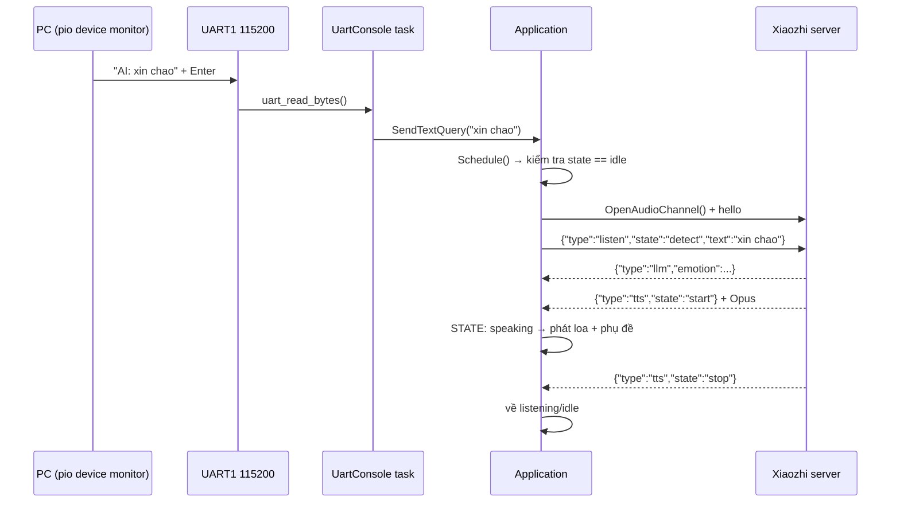

# Kết nối WiFi và nói chuyện với Xiaozhi AI bằng text qua UART

Hướng dẫn này áp dụng cho board **xiaozhi-ai-iot-vietnam-es3n28p-lcd-2.8**
(ESP32-S3 N16R8) với firmware trong repo này.

---

## 0. Chuẩn bị

| Thứ cần | Giá trị |
|---|---|
| Cáp USB | cắm vào cổng USB của board (UART0 qua chip USB–Serial, 115200 8N1) |
| Lệnh nạp | `pio run --target upload` |
| Xem log | `pio device monitor` (115200) — **UART0**, không dùng để gõ text |
| Gõ text chat | **USB-TTL rời** nối vào UART1: TX=GPIO21, RX=GPIO20, GND, 115200 8N1 |
| WiFi | **2.4 GHz**, WPA2 (ESP32-S3 không hỗ trợ 5 GHz) |

### 0.1 Đấu dây UART text (UART1)

Console text chạy trên **UART1** xuất ra chân, tách khỏi UART0 nên log ESP vẫn
chạy bình thường trên cổng USB:

```
Board                  USB-TTL (3.3 V)
GPIO21  (UART1 TX) --> RX
GPIO20  (UART1 RX) <-- TX
GND                --- GND
```

- Mức 3.3 V, **không** dùng adapter 5 V.
- Trên PC mở terminal 115200 8N1 cho cổng COM của USB-TTL:
  `pio device monitor --port COMx --baud 115200` (hoặc PuTTY/RealTerm).
- GPIO20 đồng thời là USB D+ của ESP32-S3. Nếu cổng USB trên board dùng USB
  native trực tiếp của chip, dùng GPIO20 làm UART RX có thể gây xung đột; hãy
  xác nhận sơ đồ board trước khi đấu.
- Đổi chân: sửa `CONSOLE_UART_TX_PIN` / `CONSOLE_UART_RX_PIN` / `CONSOLE_UART_NUM`
  trong `src/uart_console.h`.

> **Nếu console tự lặp lại chính nó** — log đầy dòng rác kiểu
> `> > :����� de xem traF+��` kèm `Text query ignored` liên tục — thì chân
> **GPIO20 (RX)** đang bị thả nổi hoặc bị nối nhầm vào **GPIO21 (TX)**:
> board nghe lại chính tiếng của nó rồi in tiếp, tạo vòng lặp khuếch đại.
> Firmware đã tự bật pull-up cho RX và tự tạm dừng đọc khi phát hiện bão dữ
> liệu, nhưng phải sửa dây: `USB-TTL TX → GPIO20`, `USB-TTL RX → GPIO21`,
> `GND chung`; **không** nối TX–TX hay để RX lơ lửng.
- Khi khởi động, terminal này in banner:

  ```
  ================================
   Xiaozhi text console ready
   UART1 @ 115200 8N1, TX=GPIO21, RX=GPIO20
   media: ON (voice)
   go 'help' de xem lenh, 'media off' de chat bang text
  ================================
  ```

---

## 1. Kết nối WiFi

### Trường hợp A — thiết bị chưa có cấu hình WiFi (lần đầu)

1. Cấp nguồn cho board.
2. Thiết bị không tìm thấy SSID nào đã lưu → tự mở **AP cấu hình**, màn hình hiện
   hướng dẫn và loa đọc "chế độ cấu hình WiFi".
3. Trên điện thoại/máy tính, vào WiFi và chọn:

   ```
   TienHuyIoT-XXXX        (XXXX = 2 byte cuối của MAC)
   ```

4. Trình duyệt sẽ tự mở **captive portal**; nếu không, vào `http://192.168.4.1`.
5. Chọn SSID nhà → nhập mật khẩu → **Connect/Save**.
6. Thiết bị lưu vào NVS, tự khởi động lại và kết nối vào WiFi nhà.

### Trường hợp B — đổi sang mạng WiFi khác

- Nhấn giữ/nhấn **5 lần** nút **BOOT** (GPIO0) → thiết bị ghi cờ `force_ap`,
  reboot và vào lại AP cấu hình như bước 2 ở trên.
- Hoặc nhấn BOOT **1 lần** trong lúc màn hình còn ở trạng thái *starting* và
  chưa kết nối được WiFi → cũng vào AP cấu hình.

### Trường hợp C — đã có WiFi

Thiết bị tự kết nối khi khởi động. Xác nhận bằng một trong hai cách:

- Log UART0 (`pio device monitor`):
  ```
  WifiStation: Got IP: 192.168.x.y
  ```
- Hoặc xem IP trên status bar của LCD.

Tiện ích: khi đã vào mạng, **OTA server nội bộ** chạy ở `http://<ip>/` để nạp
firmware bằng trình duyệt.

### Trường hợp D — nhập SSID/password ngay trên console UART (không cần điện thoại)

Console UART1 (GPIO21/GPIO20) có sẵn nhóm lệnh `wifi`, dùng được **cả khi thiết bị
đang ở chế độ AP cấu hình** và **cả khi `media ON`**:

| Lệnh | Tác dụng |
|---|---|
| `wifi` (hoặc `w`) | Xem đang kết nối hay không, IP, RSSI, và danh sách mạng đã lưu |
| `wifi <ssid> <password>` | Lưu vào NVS rồi **tự khởi động lại** để kết nối |
| `wifi scan` | Quét AP xung quanh: tên / kênh / RSSI / authmode |
| `wifi ap` | Ghi cờ `force_ap` và reboot vào AP cấu hình `TienHuyIoT-XXXX` |
| `wifi clear` | Xoá toàn bộ mạng đã lưu rồi reboot |

Ví dụ (SSID/password giữ nguyên chữ hoa–thường, phân tách bằng dấu cách):

```
wifi TienHuyIoT 12345678
wifi
wifi scan
```

- Password rỗng = mạng open: `wifi TenMangMo`
- SSID tối đa 32 ký tự, password tối đa 64 ký tự (vượt quá sẽ bị từ chối).
- `wifi scan` là cách nhanh nhất để kiểm tra vì sao không thấy mạng nhà: nếu AP
  của bạn **không xuất hiện** trong danh sách thì nguyên nhân thường là router
  phát **5 GHz** (ESP32-S3 chỉ có 2.4 GHz), **SSID ẩn**, hoặc kênh **12/13**
  (mặc định chip chỉ quét kênh 1–11 vì chưa set country code).

> Nếu AP `TienHuyIoT-XXXX` không xuất hiện: kiểm tra board đã có firmware này chưa,
> thử `pio device monitor` xem log khởi động, và chắc chắn không bấm BOOT liên tục.

---

## 2. Chat với Xiaozhi AI bằng text qua UART

> **Bắt buộc: đang ở chế độ `media OFF`.** Bật/tắt bằng lệnh `media off` / `media on`
> ngay trong console UART (xem mục 2.0). Chế độ được lưu vào NVS nên reboot vẫn giữ.

### 2.0 Chế độ media: voice hay text

| Chế độ | Mic | Loa | Cách giao tiếp |
|---|---|---|---|
| `media on` (mặc định) | bật | bật | nói "hi ESP" / nhấn nút — như trợ lý bình thường |
| `media off` | **tắt** | **tắt** | gõ `AI: <câu hỏi>` trong terminal UART1 |

Lệnh:

```
media            -> xem đang ON hay OFF
media off        -> tắt mic + loa, chuyển sang chat bằng text
media on         -> bật lại mic + loa
media toggle     -> đảo chế độ
```

Khi `media off`:

- Không chạy wake word, không mở micro, loa bị mute (kể cả âm thanh UI).
- Chỉ dòng bắt đầu bằng `AI:` được gửi lên server như câu nói của người dùng.
- Các lệnh Bluetooth `cm00`..`cm09` và lệnh điều khiển loa được xử lý riêng,
  không gửi tới AI. Dòng không nhận dạng được cũng không bị gửi nhầm tới AI.
- Câu trả lời hiện trên UART với tiền tố `AI:` và trên LCD, **không phát ra loa**.
- Nút BOOT / cảm ứng không mở phiên thoại (màn hình báo `MEDIA OFF`).
- Lượt chat kết thúc ngay sau khi server đọc xong (`listen/stop` được gửi đi),
  thiết bị về `idle` — không chờ timeout.

Sau khi thiết bị đã vào WiFi, ở trạng thái **idle** và đang `media OFF`:

```powershell
pio device monitor --port COMx --baud 115200   # COMx = USB-TTL nối GPIO21/GPIO20
```

Gõ tiền tố `AI:` rồi đến câu hỏi và nhấn Enter:

```
AI: xin chao
```

Thiết bị sẽ:

1. Mở kênh audio (WebSocket hoặc MQTT tuỳ cấu hình server).
2. Gửi JSON:

   ```json
   {"session_id":"<id>","type":"listen","state":"detect","text":"xin chao"}
   ```

   Server coi `text` này **chính là câu người dùng nói** (bỏ qua bước ASR),
   đi thẳng vào LLM → TTS.
3. Câu trả lời được in ra UART (`UartConsole: AI: ...`) và hiện phụ đề trên LCD.

### Các lệnh của console text

| Gõ | Tác dụng |
|---|---|
| `AI: <câu hỏi>` | gửi phần sau `AI:` lên Xiaozhi AI (chỉ khi `media off`) |
| `cm00`..`cm09` | điều khiển/test loa Bluetooth qua ESP-NOW, không gửi tới AI |
| `media on\|off\|toggle` | bật/tắt mic + loa |
| `media` | xem chế độ media hiện tại |
| `help` | in danh sách lệnh |
| `state` | in trạng thái hiện tại (`idle`, `listening`, `speaking`, …) |

Mọi dòng không phải lệnh hợp lệ chỉ được coi là câu hỏi AI nếu có tiền tố
`AI:` (không phân biệt hoa/thường). Ví dụ `AI: xin chao` được gửi đi, còn
`xin chao` chỉ hiện hướng dẫn cách nhập; `cm01` luôn chạy lệnh quét Bluetooth.

### Điều kiện và giới hạn (quan trọng)

- **Chỉ gửi được khi `state = idle`.** Nếu đang xử lý, log sẽ báo
  `Text query ignored: device is listening, wait until idle`.
- **Chỉ gửi được khi `media OFF`.** Nếu `media ON`, log báo
  `media dang ON - hay noi voi thiet bi, hoac go 'media off' ...`.
- Câu **ngắn** (vài chục ký tự). Server giới hạn tần suất với kiểu gọi này
  (nó dùng chung đường với *wake word detect*).
- Text được gửi **giống hệt** khi bạn nói từ khoá đánh thức: server nhận
  `listen/detect` + `text`; nội dung text được tính là câu của người dùng.
- Cách này chạy cho **cả hai** giao thức WebSocket và MQTT vì cùng dùng
  `Protocol::SendText()`.

### Ví dụ log khi thành công

```
UartConsole: Text console ready - media OFF (UART text), type 'help'
UartConsole: > xin chao
Application: Text query: xin chao
Application: STATE: connecting
Application: STATE: listening
Application: << Hôm nay trời nhiều mây.
UartConsole: AI: Hôm nay trời nhiều mây.
Application: STATE: speaking
Application: STATE: idle
```

---

## 3. Luồng hoạt động



---

## 4. Code liên quan

| File | Nội dung |
|---|---|
| `src/uart_console.h/.cc` | task đọc UART1 từng dòng; lệnh `media`, `help`, `state`; chỉ `AI: <câu hỏi>` gửi thành text (khi `media off`); lệnh Bluetooth được tách riêng |
| `src/application.h/.cc` | `SetMediaEnabled()` / `IsMediaEnabled()` / `ToggleMediaEnabled()`, `SendTextQuery()`, `SelectListeningMode()` |
| `src/audio/audio_service.h/.cc` | `SetMediaEnabled()` — tắt wake word, mic, loa, bỏ packet TTS và mute âm thanh UI |
| `src/protocols/protocol.cc` | `SendWakeWordDetected()` gửi `listen/detect` + `text` (có escape JSON) |

Chế độ media lưu ở NVS: namespace `media`, key `enabled` (`1` = voice, `0` = text).
Xoá cấu hình: `idf.py erase-flash` hoặc gọi `Settings("media", true).EraseAll()`. Thực
tế chỉ cần gõ `media on` để bật lại.

Luồng text (`media off`): `listen/detect` → `listen/start` (mode `manual`) → server
trả `stt` / `llm` / `tts` (audio bị bỏ) → `tts stop` → thiết bị gửi `listen/stop`
và về `idle`. Không có mic mở nên không cần chờ timeout 60 s.
